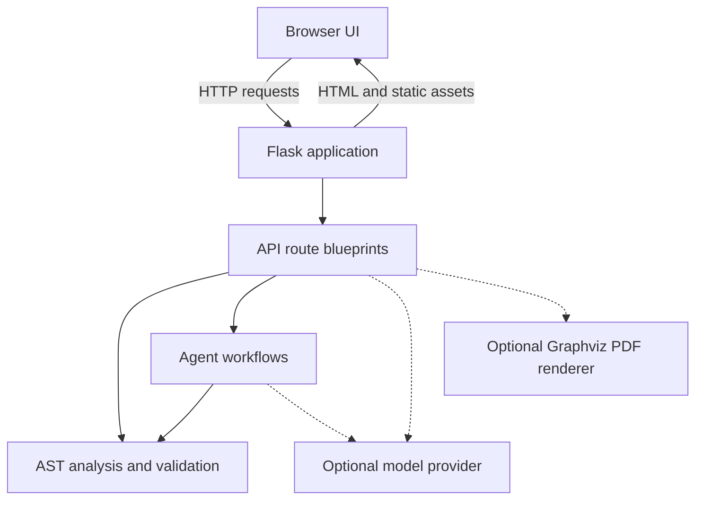

# Intelligent Code Comment Generator

## Architecture

This project is a browser-based Python code review workbench. A Flask application
serves both the frontend and its JSON API. The backend parses submitted Python
into an AST, applies deterministic analysis, and optionally uses a configured
language-model provider for selected features. Submitted code is analyzed as
text; it is not executed by the analysis or agent workflows.

### System overview



### Main code paths

**Comment generation** (`POST /generate`) runs the standard pipeline:

```text
source code
  -> AST analysis and type inspection
  -> deterministic rules and warnings
  -> AI comment generation, or deterministic AST comments
  -> generated-code validation
  -> quality/review scores and API response
```

The pipeline is implemented in `backend/pipeline.py`. Its analysis,
generation, and validation work is provided by `ast_analyzer.py`,
`rules.py`, `code_analysis.py`, and `validator.py`. If AI output is unavailable
or fails validation, the pipeline uses its documented deterministic fallback;
code with detected type errors also uses deterministic comments.

**Other review features** use the same analysis services where applicable:

- `/analyze` returns structural, quality, and security findings without
  generating comments.
- `/assist` provides static editor feedback; `/assist/ai` requests an optional
  model-backed inline suggestion and validates it before returning it.
- `/assistant` provides code guidance; `/assistant/improve` returns a
  candidate for review rather than applying or executing it.
- `/agent/*` exposes bounded analysis, optimization, security, remediation,
  multi-agent, and professor/student workflows.
- `/agentic/*` is a separate stateful supervisor workflow. It uses registered
  tools, a session plan, checkpoints, and an event stream; session state is
  held in memory, not in a database.
- `/open_ast_pdf` and `/download_ast_pdf` render an AST visualization when
  Graphviz is installed.

### Application layers

| Layer | Responsibility | Main files |
| --- | --- | --- |
| Web client | Editor, results, settings, and API requests | `frontend/index.html`, `frontend/script.js`, `frontend/styles.css` |
| Flask entry points | App creation, shared request middleware, route registration, and server startup | `backend/app.py`, `run.py`, `wsgi.py` |
| HTTP route groups | UI, analysis, editing, assistant, agent, security, settings, and PDF endpoints | `backend/app.py`, `backend/agentic/routes.py` |
| Analysis and generation | Python AST facts, type findings, deterministic rules, comment generation, and validation | `backend/ast_analyzer.py`, `backend/type_analyzer.py`, `backend/rules.py`, `backend/code_analysis.py`, `backend/validator.py`, `backend/pipeline.py` |
| AI integration | Provider configuration, client creation, prompt construction, and provider error handling | `backend/config.py`, `backend/model_provider.py`, `backend/prompt_builder.py`, `backend/provider_errors.py` |
| Agent workflows | Bounded tools, optimization, security review/remediation, orchestration, and stateful sessions | `backend/agent.py`, `backend/multi_agent_orchestrator.py`, `backend/agentic/` |
| Shared support | Request normalization, editor assistance, security guardrails, and AST visualization | `backend/request_utils.py`, `backend/editor_assist.py`, `backend/attack_guard.py`, `backend/visualise.py` |
| Verification | API, feature, agent, real-world, and frontend asset tests | `tests/`, `conftest.py` |

### Agent workflow distinction

There are multiple agent entry points, with different responsibilities:

1. **Bounded analysis agent — `/agent/run`:** a model selects from four
   allowlisted, read-only analysis tools, within a capped number of calls. It
   cannot execute code, access files or networks, or edit the submitted source.
2. **Collaborative workflow — `/agent/multi-agent-workflow`:** runs optimization,
   static security analysis, remediation, and deterministic verification in
   sequence. It returns a candidate and findings for human review.
3. **Stateful agentic workflow — `/agentic/run`:** a supervisor builds a plan
   from specialized agents and runs registered tools against a session. The
   related endpoints expose session state, Server-Sent Events, available tools,
   and approve/reject actions.

These are separate paths, not one shared agent pipeline. Agent-produced code
changes are candidates for review, not proof of correctness or security.

### API route map

| Route group | Representative endpoints | Purpose |
| --- | --- | --- |
| Health and settings | `GET /health`, `/api/settings`, `POST /api/test-provider` | App health and model-provider configuration |
| Analysis and comments | `POST /analyze`, `POST /generate` | Static review and commented-code generation |
| Editor and assistant | `POST /assist`, `/assist/ai`, `/assistant`, `/assistant/improve` | Editor feedback, optional inline suggestions, and code guidance |
| Agents | `POST /agent/run`, `/agent/optimize`, `/agent/simulate-attacks`, `/agent/fix-attacks`, `/agent/multi-agent-workflow`, `/agent/professor-student` | Bounded analysis and reviewable agent workflows |
| Stateful agentic | `GET /agentic/tools`, `POST /agentic/run`, `GET /agentic/stream/<session_id>`, `GET /agentic/session/<session_id>`, `POST /agentic/action` | Tool registry, workflow execution, streaming, session inspection, and human decisions |
| Security and artifacts | `GET /security/evaluate`, `POST /security/simulate-custom-attack`, `POST /open_ast_pdf`, `/download_ast_pdf` | Guardrail evaluation and AST PDF rendering |

Routes are registered by `create_app()` in `backend/app.py`. Shared request
helpers live in `backend/request_utils.py`; the stateful workflow has its own
blueprint in `backend/agentic/routes.py`.

## Run and test

Use Python 3.15 and install the pinned dependencies from the project root.
On Windows PowerShell:

```powershell
py -3.15 -m venv .venv
.\.venv\Scripts\python -m pip install -r requirements.txt
.\.venv\Scripts\python -m pytest -q
.\.venv\Scripts\python run.py
```

On Linux or macOS:

```sh
python3.15 -m venv .venv
.venv/bin/python -m pip install -r requirements.txt
.venv/bin/python -m pytest -q
.venv/bin/python run.py
```

The app serves the browser UI and JSON API from the same Flask process.
GitHub Actions runs the test suite for pushes and pull requests using the
Python version above.

The editor sends debounced source updates to `/assist` for live syntax,
undefined-name, security, and quality feedback. This is browser/API
request-response feedback, not a persistent WebSocket connection.
Optional model-backed inline suggestions are separate: enable **AI suggestions
while typing** in the editor. The current buffer is then sent to the configured
AI provider after each pause in typing, and the completion is shown as
ghost text for review (press Tab to accept). This remains disabled by default;
it is unavailable until `API_KEY` is configured. Model-generated completions
are not executed or automatically applied.

The `/assist` and `/assist/ai` completion APIs accept a cursor as a 1-based
line and 0-based UTF-16 column (matching browser/LSP conventions), or as a
0-based UTF-16 source offset. Responses include a UTF-16 `replacement_range`
and `cursor_offset` so clients replace only the intended text. AI suggestions
are checked for syntax regressions and new static security findings; rejected
suggestions are returned with an empty `suggestion` and explanatory warnings.

The **Security Lab** tab runs the labeled synthetic attack suite through
`GET /security/evaluate`. It reports confusion-matrix counts, accuracy,
precision, recall, F1, false-positive/negative rates, and mean detection
latency. The deterministic guard checks for instruction/policy overrides,
disabled safeguards, suppressed findings, credential/private-data
exfiltration, and unsafe code; AI-facing requests are blocked and logged
without recording the submitted prompt or source. The suite is a small
heuristic smoke test, not a security certification: broaden and periodically
refresh it with representative, reviewed examples before relying on metrics.

Comment generation uses the configured AI provider when available, including
GitHub Copilot, Hugging Face, and Ollama. Without the key, or if the provider
is unavailable or out of credits, the app
generates deterministic AST-based comments instead and labels the result so it
is not mistaken for AI output. Live AI suggestions and other model-backed
features still require `API_KEY`. Configure the provider key in the server
environment or an ignored `.env` file, restart the server, and reload the page
to enable model-backed features. For a local `.env` file in the project root,
copy the template and fill in your own token:

```powershell
Copy-Item .env.example .env
```

Then set the value in `.env`:

```dotenv
AI_PROVIDER=copilot
API_KEY=your_github_copilot_token
COPILOT_MODEL=gpt-4o
```

Set `AI_PROVIDER` to `huggingface`, `ollama`, `copilot`, `openai`, `gemini`,
`groq`, `anthropic`, or `ast`. The `ast` provider uses deterministic generation
without a model key. Provider-specific models, URLs, and keys are documented
in `.env.example`. Use your own token for the selected provider; never put it
in browser code or commit it. If the model is unavailable or out of provider
credits, generation transparently falls back to deterministic AST comments and
reports that mode in the result.
If model-generated output fails syntax, executable-code, or safety validation,
the rejected output is discarded and detailed deterministic AST comments are
used instead. The deterministic AST comment path is also used for code with
detected type errors, where model-generated explanations could repeat
misleading type claims. AST-generated function docstrings describe the
function's return behavior and, where recognized, explain filters, branches,
loops, and intermediate calculations.
For model-generated output, each function without an existing docstring is
documented with a substantive explanation of its purpose, execution steps,
relevant conditions, and return value or effects. Inline comments explain
meaningful non-obvious operations rather than merely repeating the code.

For local development, use the Flask development server:

```powershell
.\.venv\Scripts\python run.py
```

For a Linux production deployment, use the included Gunicorn dependency and
the WSGI app object instead of Flask's development server:

```sh
gunicorn --workers 2 --bind 0.0.0.0:${PORT:-5000} wsgi:app
```

By default, cross-origin requests are not allowed; same-origin browser use
works without CORS. Configure `CORS_ORIGINS` as a comma-separated allowlist
only when a separate trusted frontend needs API access. Allowed preflight
headers include `Content-Type`, `Authorization`, and `X-API-Key`. For trusted
API clients, `REQUIRE_API_KEY=true` protects model-backed routes and AST PDF
routes; send it in the configured `X-API-Key` request header. If key
authentication is enabled without a server-side `API_KEY`, those routes return
503 rather than appearing to reject a supplied client key. Never put the
provider key in browser code. `MAX_CONTENT_LENGTH` defaults to 1 MiB, and API
source is limited to 50,000 characters.

## Code quality and AI improvement

The Quality tab reports a heuristic score calculated from static-analysis
findings. It is not a test-coverage score, proof of correctness, or guarantee
that code is safe for production. The analyzer does not execute submitted code.

The AI Assistant's **Improve code quality** action also requires `API_KEY` to
be configured for the selected AI provider. It runs up to three bounded
improvement iterations and accepts a candidate only if it parses, preserves
function/class names, improves the static score, and does not add security
findings. The candidate is displayed for review and is never applied or
executed automatically. Review the diff and run project-appropriate tests
before using it.

When `API_KEY` is configured, the Assistant uses the model for answers and
clearly labels those responses as AI-generated. Without a key, it reports
AST-grounded guidance and identifies it as such. If a configured model request
fails or returns unusable text, the Assistant returns AST-grounded guidance
with an explicit warning; comment generation and inline completions instead
report failed or rejected generation rather than labeling fallback text as AI.

The **Run analysis agent** action is a separate, bounded tool-using workflow
available when `API_KEY` is configured. `POST /agent/run` lets the model choose
from four allowlisted, read-only tools for AST structure, static security,
quality, and type inspection. The server retains the source, tool results, and
agent decisions in the current request while allowing at most four tool calls.
It returns the execution plan, tool outputs, and deterministic verification
checks. The agent cannot run code, access files or network resources, or modify
the submitted source; its recommendations remain subject to human review.
This is a constrained analysis agent, not an autonomous coding or deployment
agent. The existing assistant endpoint remains available for compatibility.

## Multi-Agent AI Architecture

The workbench integrates multiple specialized AI agents operating individually or collaboratively in a coordinated team:

1. **AI Code Optimization Agent** (`POST /agent/optimize`):
   Analyzes selected AST patterns (quadratic sorting loops, eager aggregation lists, redundant `.keys()` iteration, and string concatenation in loops), estimates complexity and potential speedups, and proposes a candidate. Syntax, definition-name, and security checks do not establish semantic equivalence or measured performance; review changes and test them before use.

2. **Static Python Security Analyzer** (`POST /agent/simulate-attacks`):
   Performs seven deterministic, AST-based checks for dynamic SQL, dynamic code or shell execution, risky dynamic paths, unsafe deserialization, hardcoded credentials, disabled TLS verification, and untrusted AI input. It does not execute submitted code, connect to external services, or replay attack payloads. Results describe potential findings, redact detected credential values, and include defensive mitigations. The resilience score summarizes these checks only; it is not a security certification.

3. **AI Security Fixing & Remediation Agent (Blue Team)** (`POST /agent/fix-attacks`):
   Produces a reviewable candidate patch for supported static findings, using deterministic remediations when available and a model candidate when configured. It checks candidate syntax, preserves definition names, and re-runs the same static checks; model candidates that add finding categories are rejected. A clean result means only that these implemented checks found no remaining findings, not that every vulnerability is fixed or that behavior is equivalent. Review the diff and run project-specific tests before applying a patch.

4. **Multi-Agent Collaborative Orchestrator** (`POST /agent/multi-agent-workflow`):
   Coordinates an automated 4-stage pipeline:
   - **Stage 1**: Optimizer Agent enhances algorithmic performance.
   - **Stage 2**: Static Python Security Analyzer checks the candidate source; it does not run exploits or execute submitted code.
   - **Stage 3**: Remediation Agent proposes defensive changes for reported findings.
   - **Stage 4**: Verification Agent checks syntax, static findings, and quality scores. A clean result from these checks is not a security certification.

The static analysis and deterministic fallback paths do not require a model provider. Model-backed features can fail when provider configuration, connectivity, or credits are unavailable; those failures are reported rather than guaranteed away.

## Where to find things

### Backend (`backend/`)

| Module | Responsibility |
| --- | --- |
| `app.py` | `create_app()` composition root, shared HTTP middleware, and feature-grouped Blueprints for UI, analysis, editing, assistant, agent, security, and PDF routes. |
| `optimization_agent.py` | AI Code Optimization Agent: algorithmic complexity analysis, speedup estimation, and safe AST optimizations. |
| `security_attack_agent.py` | Static Python Security Analyzer: AST-based security checks; submitted code and synthetic inputs are never executed. |
| `security_fixing_agent.py` | Security remediation agent: reviewable candidate patches and repeated static-check results. |
| `multi_agent_orchestrator.py` | Multi-Agent Collaborative Orchestrator coordinating the 4-stage optimization and defense pipeline. |
| `agent.py` | Runs bounded model-directed analysis with an allowlisted set of read-only tools and post-run verification. |
| `provider_errors.py` | Classifies model-provider failures into safe, provider-neutral API error messages and status codes. |
| `request_utils.py` | Shared JSON-body, code-field, cursor, and undefined-name finding helpers. |
| `assistant.py` | Builds assistant replies and next-step suggestions from analysis findings. |
| `attack_guard.py` | Detects adversarial prompts and suspicious code, blocks high-risk AI inputs, and evaluates a labeled simulation suite. |
| `pipeline.py` | Runs analysis, rules, comment generation, validation, and scoring in order. |
| `ast_analyzer.py` | Parses Python and extracts structure, complexity, and behavior explanations. |
| `type_analyzer.py` | Finds definite type mismatches and related expression facts. |
| `rules.py` | Converts AST facts into security, correctness, and maintainability warnings. |
| `code_analysis.py` | Uses the configured AI provider for comment generation; uses AST comments for detected type errors. |
| `prompt_builder.py` | Constructs the grounded AI prompt and analysis context. |
| `validator.py` | Checks Python syntax, undefined names, and whether generated comments preserve executable code. |
| `editor_assist.py` | Creates cursor-aware completions and syntax warnings. |
| `visualise.py` | Renders the AST as a PDF when Graphviz is installed. |
| `models.py` | Shared warning data shape. |
| `config.py` | Environment-based Flask configuration. |

### Frontend (`frontend/`)

| File | Responsibility |
| --- | --- |
| `index.html` | Page structure, editor, result tabs, and examples. |
| `script.js` | Editor interactions and calls to the backend API. |
| `styles.css` | Layout, editor highlighting, and component styling. |

### Tests

`tests/test_backend.py` checks the API contracts and core analysis/generation behavior. The files in `sample example/` are sample inputs; some intentionally contain errors for analyzer tests.

## Main request flow

1. `app.py` validates an incoming request and selects the endpoint.
2. `/analyze` uses the AST analyzer and deterministic rules.
3. `/generate` runs the full pipeline: AST analysis → warnings → comments → validation → quality scoring.
4. `/assistant` and `/assist` provide code guidance and cursor completions.
5. The frontend displays results; submitted Python source is analyzed, not executed.

After successful comment generation, use **Download AST Graph PDF** in the
output panel to download a Graphviz-rendered PDF for the generated source's AST.
This action requires Graphviz's `dot` executable on the server `PATH`; the
editor's **View AST PDF** action remains available for opening the current
source graph in a browser tab.
