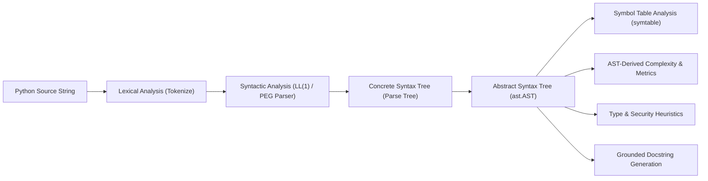

# Intelligent Code Comment Generation via Abstract Syntax Trees (AST)
## AST Studio: An AI-Powered Autonomous Multi-Agent Python Software Engineering & Verification Workbench

---

## 1. Abstract / Executive Summary

Software maintenance accounts for up to 70% of total lifecycle software engineering expenditures. A dominant factor in developer onboarding, code review velocity, and software reliability is the presence—or absence—of accurate, contextually grounded documentation and security auditing. While Generative AI and Large Language Models (LLMs) have emerged as powerful assets for code synthesis, naive LLM-based documentation often suffers from hallucinations, ungrounded parameter descriptions, omission of edge cases, and the hazardous introduction of security regressions or syntax corruption.

**AST Studio** bridges the gap between formal language theory and modern neural intelligence. Developed as an academic and engineering workbench for Python source inspection, AST Studio parses submitted code into an **Abstract Syntax Tree (AST)** using Python's standard-library compiler frontend (`ast`, `symtable`, and `tokenize`). It grounds all subsequent code commentary, quality scoring, vulnerability remediation, and multi-agent workflows in verifiable syntactic and lexical facts. 

AST Studio features the **NEXUS Autonomous Multi-Agent Swarm**, an orchestrated workforce comprising six distinct specialist agents—**ATLAS** (Architecture), **FORGE** (Code Quality), **SENTINEL** (Defensive Security), **REMEDY** (Patch Generation), **SCRIBE** (Documentation), and **VERITY** (Independent Verification). The system provides both **AI Model Mode** (supporting `openai`, `gemini`, `groq`, `anthropic`, `ollama`, `huggingface`, and `copilot`) and **Offline / Deterministic Mode** (`ast`, relying 100% on deterministic compiler theory with zero network calls or external API dependencies). Submitted code is analyzed strictly as static text in a sandbox—arbitrary execution is strictly prevented.

---

## 2. 5-Minute "Run It" Quickstart

Get AST Studio running on your local machine in five minutes with zero external build tools required (pure Python backend and vanilla HTML5/ES6 frontend):

### Windows (PowerShell)

```powershell
# 1. Clone repository & enter workspace
git clone <repository_url>
cd Intelligent_CodeCommentGenerationViaAST

# 2. Create and activate a Python 3.12 (or 3.13) virtual environment
python -m venv .venv
.\.venv\Scripts\Activate.ps1

# 3. Install dependencies
pip install -r requirements.txt

# 4. Copy environment configuration template
Copy-Item .env.example .env

# 5. Start the application
python run.py
```

### Linux / macOS (bash)

```bash
# 1. Clone repository & enter workspace
git clone <repository_url>
cd Intelligent_CodeCommentGenerationViaAST

# 2. Create and activate a Python 3.12 (or 3.13) virtual environment
python3 -m venv .venv
source .venv/bin/activate

# 3. Install dependencies
pip install -r requirements.txt

# 4. Copy environment configuration template
cp .env.example .env

# 5. Start the application
python run.py
```

Open **`http://127.0.0.1:5000`** in your browser. By default, `AI_PROVIDER=ast` requires **no API keys** and runs completely offline!

---

## 3. Academic & Theoretical Foundations

AST Studio is rooted in foundational principles from the **Theory of Automata**, **Formal Language Theory**, and **Compiler Construction**:



### A. Formal Grammars and Lexical Analysis
Python's grammar is defined as a Parsing Expression Grammar (PEG). AST Studio utilizes `tokenize` and `ast` to perform deterministic tokenization:
$$\Sigma = \{\text{keywords}, \text{identifiers}, \text{literals}, \text{operators}, \text{delimiters}\}$$
Tokens are validated for lexical validity and UTF-8 encoding integrity before parse tree construction.

### B. Abstract Syntax Tree (AST) Extraction
Unlike Concrete Syntax Trees (CSTs) which retain syntactic tokens like commas, colons, and parentheses, the AST distills the structural and logical semantics of the program:
$$\mathcal{T} = (V, E, r, \lambda)$$
where $V$ represents syntax nodes (e.g., `FunctionDef`, `Assign`, `BinOp`, `Call`), $E$ represents directed parent-child relationships, $r \in V$ is the root `Module` node, and $\lambda: V \to \text{NodeType}$ labels each node with its syntactic semantics.

### C. Symbol Table & Scope Resolution
Using Python's standard `symtable` module, the engine models lexical scoping rules (Local, Enclosing, Global, Built-in — LEGB) across blocks, nested functions, and class definitions, identifying undeclared variables and shadowed symbols without runtime execution.

### D. AST-Derived Cyclomatic Complexity Estimation
Cyclomatic complexity evaluates the number of linearly independent execution paths through program modules. Rather than constructing a full control flow graph (CFG), AST Studio calculates an **AST-derived complexity estimate** by systematically counting syntactic decision points directly on the abstract syntax tree:
$$M = 1 + \sum d_i$$
where $d_i$ represents decision nodes: branching constructs (`If`, `IfExp`), loop headers (`For`, `AsyncFor`, `While`), exception handlers (`ExceptHandler`), context managers (`With`, `AsyncWith`), pattern-matching branches (`match_case` and pattern guards), assertions (`Assert`), and chained boolean operations (`BoolOp` clauses for `and`/`or`). Traversal is scoped strictly per function definition to avoid inflating parent function complexity with nested callable definitions.

### E. Static vs. Dynamic Program Analysis
AST Studio operates strictly within the domain of **Static Program Analysis**. Submitted code is treated as immutable data. Abstract interpretation, pattern recognition, and type constraint inference take place without instantiating Python virtual machine bytecodes or invoking `eval()`/`exec()`.

---

## 4. What is Static vs. Model-Backed?

To ensure complete scientific transparency and academic honesty, the boundary between deterministic compiler analysis and neural language generation is strictly separated:

| Capability | Static Engine (`AI_PROVIDER=ast`) | AI Model-Backed Mode | Grounding & Validation Guardrail |
| :--- | :--- | :--- | :--- |
| **AST Parsing & Metrics** | `ast.parse`, `symtable`, AST-derived CC, tokenized Halstead volume | Identical (always uses deterministic AST) | Compiler-level syntax checking (`compile()`) |
| **Missing Docstring Detection** | Exact AST node inspection (`ast.get_docstring`) | Identical (detected via AST) | Bounded by function/class definition nodes |
| **Docstring Generation** | Deterministic template grounded in AST parameter list & return type | LLM synthesizes natural English description | Rejects docstrings mentioning nonexistent parameters; validates code via `validator.py` |
| **Security Scanning** | Static AST node visitor & entropy-based secret scanning | LLM reasoning informed by detected AST findings | Invariant check: cannot delete unrelated code |
| **Patch Generation (REMEDY)** | Deterministic AST rewrite rules (e.g., `os.system` $\to$ `subprocess.run`) | LLM surgical patch suggestion | Mandatory human approval gate; unified diff review |
| **Verification (VERITY)** | Deterministic AST parse & interface preservation check | Deterministic AST parse & interface preservation check | Automated verification gate; never bypassed |
| **Project Dependencies** | Static import graph extraction (`ast.Import`, `ast.ImportFrom`) | Identical (always uses AST import graph) | Detects circular imports statically |
| **Behavioral Tests** | Restricted disposable subprocess execution (opt-in) | Restricted disposable subprocess execution (opt-in) | `ALLOW_PROJECT_TEST_EXECUTION=false` by default |

---

## 5. Measured Performance Benchmarks

All latency measurements are empirically benchmarked using `scripts/benchmark.py` across three representative Python samples (5-line function, 16-line multi-branch module, and 24-line class, measured over 50 iterations each in deterministic `AI_PROVIDER=ast` mode):

| Stage | Benchmark Script Component | Measured Mean Latency | Throughput |
| :--- | :--- | :--- | :--- |
| **AST Parsing & Metrics** | Lexing, parsing, symbol table, AST decision complexity | **~2.2 ms – 8.0 ms** | ~125–450 files/sec |
| **Security AST Pattern Scan** | CWE-89, CWE-78, CWE-798, CWE-502, CWE-327, secrets | **~5.9 ms – 25.4 ms** | ~40–170 files/sec |
| **Docstring & Fact Extraction** | Parameter annotations, docstring extraction, comment gen | **~0.6 ms – 4.7 ms** | ~215–1,700 files/sec |
| **Full Static Pipeline** | Complete parse, metrics, security audit, and comment gen | **~9.6 ms – 38.3 ms** | **~26–105 files/sec** |

*Note: Latency varies based on module size, AST depth, and host environment. To reproduce on your machine: `python scripts/benchmark.py`.*

---

## 6. Supported AI Model Providers

When running in **AI Model Mode**, AST Studio connects to model backends using standardized, sanitized API adapters without vendor-specific template leakage:

| Provider Key | Engine / Service | Local / Cloud | Default Model | Notes |
| :--- | :--- | :--- | :--- | :--- |
| `ast` *(default)* | Deterministic AST Compiler | **Local (Offline)** | None | Zero API key needed; 100% deterministic & hermetic |
| `openai` | OpenAI API | Cloud | `gpt-4o-mini` | Standard ChatCompletions endpoint |
| `gemini` | Google Gemini API | Cloud | `gemini-2.0-flash` | High context window & fast analysis |
| `groq` | Groq Cloud LPU | Cloud | `llama-3.3-70b-versatile` | Ultra-low-latency cloud inference |
| `anthropic` | Anthropic Claude | Cloud | `claude-3-5-sonnet-20241022` | Strict JSON schema adherence |
| `ollama` | Ollama Server | **Local (Offline)** | `qwen2.5-coder:7b` | Completely local LLM execution at `http://localhost:11434` |
| `huggingface` | Hugging Face Router | Cloud | `Qwen/Qwen3.5-35B-A3B` | Automatic provider parameter normalization |
| `copilot` | GitHub Copilot | Cloud | `gpt-4o` | Verified enterprise token gateway |

---

## 7. NEXUS Multi-Agent Swarm & Project Tools

The **NEXUS Multi-Agent Workforce** operates across six specialist agents: **ATLAS** (Architecture), **FORGE** (Quality), **SENTINEL** (Security), **REMEDY** (Patching), **SCRIBE** (Documentation), and **VERITY** (Verification). In multi-file workspace mode, agents interact with the project filesystem exclusively via bounded, sandboxed project tools:

| Project Tool Name | Capability & Security Boundary | Return Schema |
| :--- | :--- | :--- |
| `list_project_files(glob="**/*.py")` | Safely enumerates workspace files matching glob; prevents directory traversal. | List of `{path, line_count}` |
| `read_project_file(path, start_line, end_line)` | Bounded reader with line numbers; enforced hard cap of 300 lines per call. | `{path, start_line, end_line, lines}` |
| `search_project_code(pattern, max_results=20)` | Regex and plain substring workspace search; capped result limits. | List of `{file, line, snippet}` |
| `find_symbol(symbol_name)` | AST-grounded definition and reference locator across the entire project. | `{symbol, definitions: [...], references: [...]}` |
| `get_import_graph()` | Analyzes imports across all project modules; computes dependency adjacency and flags cycles. | `{modules: [...], edges: [...], circular_imports: [...]}` |
| `propose_file_patch(path, patch_content, ...)` | Non-destructive staging of file modifications; creates atomic snapshots for rollback. | `{snapshot_id, path, diff, status: "staged"}` |
| `run_isolated_behavioral_tests(test_target)` | Opt-in pytest execution in a restricted temporary workspace clone. | `{executed: bool, exit_code, stdout, stderr}` |

---

## 8. Security & Threat Modeling

AST Studio treats execution safety and static isolation as foundational requirements:

1. **Static Analysis Guarantee:** User-submitted Python code is treated as immutable data. The engine inspects AST syntax nodes and never invokes `eval()`, `exec()`, or dynamic runtime reflection.
2. **Execution Boundary for Project Tests:** The Project Workbench includes an optional test runner. However, to prevent arbitrary code execution from untrusted project archives, dynamic test execution is strictly disabled by default:
   ```bash
   ALLOW_PROJECT_TEST_EXECUTION=false   # Default: Safe mode (Tests NOT run)
   ```
   When set to `true`, tests execute within a restricted disposable subprocess with network environment variables stripped (`http_proxy`, `https_proxy`, `all_proxy` blackholed), a hard 30-second timeout, OS resource limits where supported, and capped stdout/stderr buffers. Note that this runner is a restricted subprocess environment, not a full OS-level container/jail (e.g., Docker or Linux namespaces); execution of untrusted uploaded project suites should only occur within an isolated container boundary.
3. **SSRF & Network Isolation:** In automated test and analysis environments, all outbound socket DNS queries are hermetically intercepted or validated against private IP ranges (`127.0.0.0/8`, `10.0.0.0/8`, `172.16.0.0/12`, `169.254.169.254`).
4. **Session Token Isolation:** Workflows and SSE streams require an ephemeral 256-bit cryptographically secure session token (`X-Session-Token`).

---

## 9. Known Limitations

In the interest of rigorous academic evaluation, the following architectural boundaries are acknowledged:

1. **Python-Only AST:** The AST parser utilizes the Python standard-library compiler frontend; non-Python languages (JavaScript, C++, Java) are not parsed into AST nodes.
2. **Dynamic Reflection Limits:** Dynamic meta-programming (such as `getattr(module, dynamic_string)()` or `globals()[var]()`) cannot be fully resolved at static compile time.
3. **Type Annotation Depth:** Static type analysis is heuristic and based on AST annotations and obvious literals. Complex inter-procedural type inference requires dedicated type checkers (e.g., Mypy or Pyright).
4. **Offline Mode Docstrings:** In `AI_PROVIDER=ast` mode, docstrings are systematically synthesized from AST parameters, returns, and raises, but do not contain conversational prose descriptions.

---

## 10. Technology Stack & Compatibility

- **Supported Python Versions:** **Python 3.12** and **Python 3.13** (Continuously tested in GitHub Actions CI matrix; compatible with Python 3.10+)
- **Backend:** Flask 3.1.3, Werkzeug 3.1.6
- **Grammar & Lexer:** Python standard library `ast`, `symtable`, `tokenize`
- **Persistence:** SQLite 3 (embedded, zero-configuration)
- **Frontend:** Semantic HTML5, CSS3 Custom Properties (Design Tokens), Vanilla ES6 JavaScript (zero npm build step)
- **Testing & Quality:** Pytest, Pytest-Cov, Playwright (Chromium E2E headless; install via `python -m playwright install --with-deps chromium`, run via `pytest --run-browser-tests`), Ruff

---

## 11. Academic Evaluation & Demonstration Scripts

- **Evaluation Benchmark & Report:** See [AST_Studio_End_Project_Report.pdf](AST_Studio_End_Project_Report.pdf) for the complete academic research documentation, empirical benchmarks, and system evaluations. Re-run sample benchmarks anytime with `python scripts/evaluate_samples.py`.
- **Visual Assets & Verification:** See [screenshots/](screenshots/) for high-resolution white-theme application screenshots and performance graphs.
- **Academic Packaging:** Generate a pristine, sanitized submission package containing strictly `git ls-files` with zero credentials, virtual environments, or temporary artifacts:
  ```powershell
  python scripts/build_clean_submission.py
  ```

---

## 12. License & Academic Authorship

Distributed under the **Apache-2.0 License**. See [LICENSE](LICENSE) for complete details.
Developed for academic evaluation, research, and compiler engineering coursework in Theory of Automata and Software Verification.
