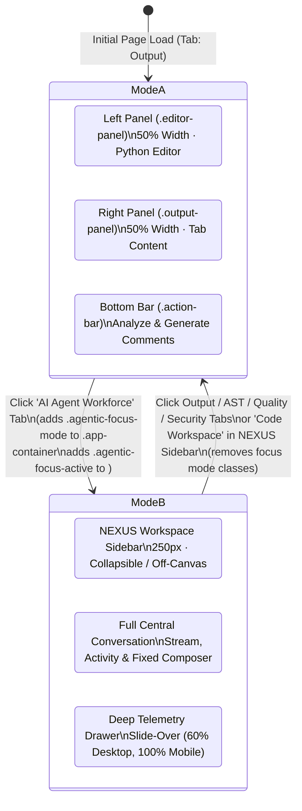

# AST Studio · Frontend Architecture Documentation

## 1. Architectural Overview & Design Philosophy

AST Studio provides two distinct developer experiences within a single coherent application:

1. **Mode A — Normal AST Development Workbench:** A dual-pane Python developer workbench for deterministic Abstract Syntax Tree analysis, code inspection, static health scoring, security sandbox attacks, and docstring synthesis.
2. **Mode B — NEXUS Focused Conversational Workspace:** A full-width, distraction-free conversational AI workspace inspired by ChatGPT and Antigravity, where the NEXUS supervisor coordinates specialist agents (ATLAS, FORGE, SENTINEL, REMEDY, SCRIBE, and VERITY).

Both modes coexist harmoniously without destroying state, reloading web pages, or losing in-progress code.

---

## 2. Layout States & Switching Mechanics

The layout state is managed by `switchTab(tabId)` in `frontend/script.js` and toggled via CSS classes on the DOM root:



### Layout Mode State Mapping

| DOM Element | Mode A (Normal AST Workbench) | Mode B (NEXUS Focused Workspace) |
|---|---|---|
| `.app-container` | `display: grid; grid-template-columns: minmax(0, 0.95fr) minmax(0, 1.05fr)` | `grid-template-columns: 1fr; padding: 0; gap: 0` (`.agentic-focus-mode`) |
| `.editor-panel` | Displayed (Editable Python code, syntax highlighter, metrics) | Visually hidden (`display: none !important`), preserved in memory |
| `.output-panel` | Occupies ~50% width | Expands to 100% viewport width |
| `.action-bar` | Visible at bottom (Analyze Only / Generate Comments) | Hidden (`display: none !important`) (`.agentic-focus-active`) |
| Top Tabs | Output, AST Insights, Quality & Health, AI Workforce, Security Lab | Identical top tabs preserved for 1-click return |

---

## 3. Component Hierarchy & DOM Contract

```
<body>
  ├── <header class="app-header glass">
  │     ├── Brand Mark & Title ("AST Studio · Autonomous AI Engineering Workspace")
  │     └── AI Engine Settings Chip (#btn-open-settings) & System Health Indicator
  │
  ├── <section id="security-alert" class="security-alert"> <!-- Conditional Banner -->
  │
  ├── <main class="app-container [agentic-focus-mode]">
  │     │
  │     ├── <section class="panel editor-panel"> <!-- Preserved in Memory -->
  │     │     ├── Editor Toolbar (Scenario Selector, Open File, Format, Copy, Clear, AST Diagram)
  │     │     ├── Code Container (#editor-line-numbers, #code-editor, syntax highlight)
  │     │     └── Shortcuts Bar (Keybindings & Live AI suggestion toggle)
  │     │
  │     └── <section class="panel output-panel">
  │           ├── <div class="tabs"> <!-- 5 Global Tabs -->
  │           │     ├── [Output] [AST Insights] [Quality & Health]
  │           │     └── [AI Agent Workforce] [Security Lab]
  │           │
  │           └── <div class="tab-content-container">
  │                 ├── #tab-output (Generated AST comments, Unified Diff view, Markdown export)
  │                 ├── #tab-ast (AST metrics, complexity, structural code explanations)
  │                 ├── #tab-quality (Static health gauge, 5-dimension breakdown progress tracks)
  │                 ├── #tab-security (Attack sandbox, scenario simulation, confusion matrix)
  │                 └── #tab-assistant (NEXUS Conversational Workspace)
  │                       └── <div class="nexus-conversational-workspace">
  │                             ├── <aside class="nexus-chat-sidebar"> (Conversations, Sessions, Code Workspace link)
  │                             ├── <main class="nexus-main-chat">
  │                             │     ├── <header class="nexus-chat-header"> (NEXUS badge, title, status, provider pill, [Workflow & Tools ↗])
  │                             │     ├── <div class="nexus-messages-container">
  │                             │     │     ├── #nexus-welcome-frame (Welcome, Subheading, Question, 2x2 Suggestion Cards)
  │                             │     │     ├── #nexus-chat-feed (Chat bubbles, code blocks, diffs, findings)
  │                             │     │     ├── #nexus-compact-activity-card (ATLAS, FORGE, SENTINEL, REMEDY, SCRIBE, VERITY)
  │                             │     │     └── #agentic-approval-center (Operator human-in-the-loop gate)
  │                             │     └── <footer class="nexus-composer-container">
  │                             │           ├── Context Bar (#context-file-pill, auto-hides if empty)
  │                             │           ├── Textarea (#agentic-task-input, auto-resizing)
  │                             │           └── Toolbar (AI Model/Offline, Advanced Settings toggle,
  │                             │                        Max Review Cycles, Operator Approval, Deploy, Abort, Reconnect)
  │                             └── <aside class="nexus-deep-drawer"> (Workflow DAG, Inspector, Tool Console, Review Engine)
  │
  └── <footer class="action-bar"> <!-- Normal Workbench Bottom Bar -->
        ├── Status Area (Action status dot & text)
        └── Action Buttons (#btn-analyze, #btn-generate)
```

---

## 4. File Responsibilities & Boundaries

- `frontend/index.html`: Declarative structure for both Mode A and Mode B. Holds all accessible hooks without DOM recreation.
- `frontend/styles.css`: Core design system, color tokens, layout grid for Mode A, Python source editor, output tab styles, and global modals.
- `frontend/agentic-workspace.css`: Dedicated feature stylesheet for Mode B (`.agentic-focus-mode`, sidebar, conversational stream, suggestions, compact agent cards, expandable drawer, and mobile responsive rules).
- `frontend/script.js`: Unified client controller managing editor events, tab switching, live analysis sync, AST rendering, and full asynchronous NEXUS streaming orchestration.
- `backend/app.py`: Flask application factory, determinism routes (`/analyze`, `/generate`, `/evaluate-security`).
- `backend/agentic/routes.py`: NEXUS multi-agent runtime routes (`/agentic/run`, `/agentic/stream`, `/agentic/session/<id>`, `/agentic/approve`, `/agentic/cancel`).

---

## 5. Responsive Behavior Across Breakpoints

| Viewport Breakpoint | Mode A (Workbench) | Mode B (NEXUS Focused Workspace) |
|---|---|---|
| **Desktop (1440×900 & 1280×800)** | Two-column 50/50 split. Editor on left, output on right. Bottom action bar fixed. | Full viewport width. Sidebar open (250px), central chat (860px max width centered), deep drawer slide-over (60% width). |
| **Laptop/Tablet (1024×768)** | Two-column 45/55 split. | Full viewport width. Sidebar collapsible via toggle button. Chat and composer adjust smoothly. |
| **Mobile (390×844 & 360×800)** | Stacked single column with vertical scroll. | Sidebar transforms to off-canvas drawer with backdrop. Central conversation uses 100% width. Header badges truncate with ellipsis. Composer adapts to touch viewports. Deep drawer expands to 100% width. |

---

## 6. Verification and Regression Test Coverage

The architecture is covered by automated regression tests in the test suite:
- **`tests/test_production_e2e_frontend.py`**:
  - `test_workforce_tab_navigation_and_initial_state`: Verifies navigation into Mode B and visibility of NEXUS components.
  - `test_agent_inspector_selection`: Verifies clicking specialist chips opens the deep telemetry inspector.
  - `test_deploy_nexus_workforce_execution`: Verifies streaming run and event capture.
  - `test_terminal_console_tabs_and_filtering`: Verifies telemetry console tabs.
  - `test_results_center_tab_navigation`: Verifies deliverables and diff inspection.
  - `test_operator_approval_elements_present`: Verifies the Advanced Settings dropdown and human approval gate.
- **`tests/test_frontend_assets.py`**: Validates DOM contracts, asset loading, and scenario inputs.
- **Backend Regression Suite**: 661 passed, 30 skipped (100% pass rate for active unit, integration, and security test suites; browser tests opt-in).
