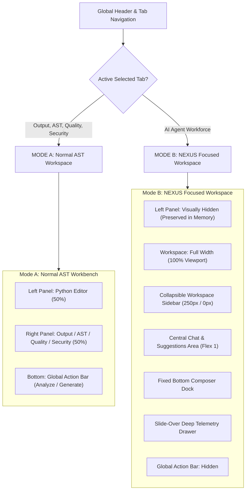

# AST Studio — Frontend Architecture Redesign Plan

## 1. Executive Summary & Existing Architecture Audit

### 1.1 Existing Architecture
AST Studio is a dual-purpose developer workbench combining deterministic AST analysis (Python code parsing, docstring generation, quality scoring, defensive vulnerability probing) with an autonomous multi-agent engineering workforce (**NEXUS** supervising specialist agents ATLAS, FORGE, SENTINEL, REMEDY, SCRIBE, and VERITY).

The existing DOM layout is structured as follows:
- **`app-header`** (Fixed top, 60px): Branding, active AI settings button (`#btn-open-settings`), and system health indicator.
- **`app-container`** (Main viewport, flex/grid):
  - **`.editor-panel`** (`minmax(0, 0.95fr)`): Python Source Engine editor, line numbers, syntax highlighter, example scenario selector, and shortcut bar.
  - **`.output-panel`** (`minmax(0, 1.05fr)`): Tabbed outputs containing:
    1. `#tab-output`: Enterprise AST Code Documentation & unified diff viewer.
    2. `#tab-ast`: AST Insights, complexity metrics, call graph, and structural explanations.
    3. `#tab-quality`: Quality & Health scorecard gauge and static code metrics.
    4. `#tab-assistant`: AI Agent Workforce (**NEXUS** conversational workspace).
    5. `#tab-security`: Security Lab attack sandbox and defensive evaluator.
- **`action-bar`** (Fixed bottom, 60px): Status dot, "Analyze Only", and "Generate Comments" buttons.

### 1.2 Root Cause of UI Clutter & Cramping
In the current design, when a user switches to `#tab-assistant` (the NEXUS Agentic AI tab):
1. **Layout Squeeze:** The full conversational workspace (sidebar, central feed, composer, telemetry drawer) is forced into `.output-panel`, which only occupies ~50% of screen width (`minmax(0, 1.05fr)`).
2. **Context Competition:** The Python source editor remains fixed on the left 50% of the screen even though conversational workflows primarily operate on conversational directives, streamed findings, and unified code diffs.
3. **Redundant Global Action Bar:** The bottom `.action-bar` ("Analyze Only", "Generate Comments") remains visible at the bottom of the viewport even though NEXUS has its own dedicated composer and deployment workflow (`Deploy NEXUS`, `Abort`, `Reconnect`).
4. **Visual Density on Laptops & Tablets:** On displays < 1280px wide, having a 2-column layout containing an editor, a NEXUS sidebar, a chat pane, and an expandable drawer creates severe visual crowding.

---

## 2. Proposed Architecture: Two Distinct Application Layout Modes

To provide an unconstrained ChatGPT/Antigravity conversational experience without disturbing the original AST workbench, the application will introduce **Two Mutually Exclusive Layout Modes** driven by `.app-container` state classes:



### Mode A: Normal AST Development Workspace (Standard Mode)
- **Active when:** User clicks `Output`, `AST Insights`, `Quality & Health`, or `Security Lab`.
- **Layout Behavior:**
  - Standard two-column split (`.editor-panel` + `.output-panel`).
  - Python source editor is fully editable with syntax highlighting, shortcuts, and scenario loading.
  - Global `.action-bar` at the bottom is visible with "Analyze Only" and "Generate Comments".
  - Clean workbench optimized for code authoring and side-by-side documentation/AST inspection.

### Mode B: NEXUS Focused Workspace (Agentic Mode)
- **Active when:** User clicks `AI Agent Workforce`.
- **Layout Behavior:**
  - `document.body` or `.app-container` receives layout state class `.nexus-focused-mode`.
  - `.editor-panel` is visually hidden (`display: none`), preserving its complete DOM tree, editor contents, cursor position, and event listeners intact.
  - `.output-panel` transitions to full width (`grid-template-columns: 1fr` or `width: 100%`).
  - `.action-bar` is hidden (`display: none`), eliminating visual collision with the bottom composer.
  - Global app header and tab navigation remain visible at the top so the user can switch back to any standard tab instantly with one click.
  - Clicking "Code Workspace" in the NEXUS sidebar seamlessly switches back to `tab-output` and restores Mode A.

---

## 3. NEXUS Focused Workspace Component Hierarchy

```
<main class="app-container nexus-focused-mode">
  │
  ├── <section class="panel editor-panel" style="display:none"> <!-- In-memory preserved -->
  │
  └── <section class="panel output-panel" style="width: 100%">
        ├── <div class="tabs"> <!-- Global workbench tabs preserved -->
        │     ├── [Output] [AST Insights] [Quality & Health]
        │     └── [AI Agent Workforce (Active)] [Security Lab]
        │
        └── <div class="tab-content-container">
              └── <div id="tab-assistant" class="tab-pane active">
                    └── <div class="nexus-conversational-workspace">
                          │
                          ├── 1. <aside class="nexus-chat-sidebar"> <!-- Left Collapsible Sidebar -->
                          │     ├── Brand / Header (AST Studio · NEXUS Supervisor)
                          │     ├── New Conversation Button (#btn-nexus-new-chat)
                          │     ├── Navigation Links (Code Workspace, Project Files, Reports, Settings)
                          │     ├── Recent Conversations List
                          │     ├── Active Agent Sessions List
                          │     └── Footer Model Provider Card
                          │
                          ├── 2. <main class="nexus-main-chat"> <!-- Central Chat Area -->
                          │     ├── <header class="nexus-chat-header"> <!-- Compact Header -->
                          │     │     ├── Left: Mobile Sidebar Toggle, NEXUS Badge, Title, Status
                          │     │     └── Right: Compact Provider/Model Pill, [Workflow & Tools ↗]
                          │     │
                          │     ├── <div class="nexus-messages-container"> <!-- Scrollable Feed -->
                          │     │     ├── Welcome Card (Centered, 2x2 Suggestion Cards)
                          │     │     ├── Chat Feed (User messages, NEXUS streaming bubbles)
                          │     │     └── Live Specialist Activity Card (ATLAS, FORGE, SENTINEL, REMEDY, SCRIBE, VERITY)
                          │     │
                          │     └── <footer class="nexus-composer-container"> <!-- Bottom Fixed Composer -->
                          │           ├── Active Context Pill (auto-hides when code is empty)
                          │           ├── Multiline Textarea (#agentic-task-input)
                          │           └── Toolbar (AI Model/Offline select, Advanced Settings toggle,
                          │                        Max Review Cycles, Operator Approval, Deploy, Abort, Reconnect)
                          │
                          └── 3. <aside class="nexus-deep-drawer"> <!-- Off-Canvas Slide Drawer -->
                                ├── Drawer Header (Title, Close ✕)
                                ├── Navigation Bar (DAG, Handoffs, Inspector, Terminal, Review)
                                └── Telemetry Panes (Workflow Graph, Comms, Agent Logs)
```

---

## 4. File Modification & Modularization Plan

### 4.1 Target File Changes (Zero Breaking Changes to Existing APIs)
1. **`frontend/styles.css` (or modular `frontend/agentic-workspace.css`):**
   - Add `.app-container.nexus-focused-mode` rules:
     ```css
     .app-container.nexus-focused-mode {
         grid-template-columns: 1fr !important;
         padding: 0 !important;
         gap: 0 !important;
     }
     .app-container.nexus-focused-mode .editor-panel {
         display: none !important;
     }
     .app-container.nexus-focused-mode .output-panel {
         border-radius: 0 !important;
         border: none !important;
     }
     body.nexus-mode-active .action-bar {
         display: none !important;
     }
     ```
   - Retain full responsiveness for tablet (`<= 1024px`) and mobile (`<= 680px`).

2. **`frontend/script.js`:**
   - Update `switchTab(tabId)`:
     ```javascript
     function switchTab(tabId) {
         document.querySelectorAll('.tab-btn').forEach(b => b.classList.remove('active'));
         document.querySelectorAll('.tab-pane').forEach(p => p.classList.remove('active'));
         
         document.querySelector(`.tab-btn[data-tab="${tabId}"]`)?.classList.add('active');
         document.getElementById(tabId)?.classList.add('active');

         const appContainer = document.querySelector('.app-container');
         const isNexus = (tabId === 'tab-assistant');
         if (appContainer) {
             appContainer.classList.toggle('nexus-focused-mode', isNexus);
         }
         document.body.classList.toggle('nexus-mode-active', isNexus);
     }
     ```
   - Wire sidebar's `#nav-nexus-code-editor` to trigger `switchTab('tab-output')` seamlessly.

3. **`frontend/index.html`:**
   - Maintain all existing IDs, buttons, and compatibility hooks.
   - Clean structure conforming to the component hierarchy above.

---

## 5. Responsive Behavior Across Breakpoints

| Viewport | Mode A (Normal Workbench) | Mode B (NEXUS Focused Workspace) |
|---|---|---|
| **Desktop (1440×900 & 1280×800)** | Balanced 50/50 split between Editor and Output. Bottom action bar fixed. | Full-width workspace. Sidebar open (250px), central chat (800px max centered), deep drawer slide-over (60% width). |
| **Laptop/Tablet (1024×768)** | Two columns adjust to 45/55 split. | Full-width. Sidebar collapsible via button or auto-compact. Composer spans available width. |
| **Mobile (390×844 & 360×800)** | Single column stacked layout. Scrollable vertically. | Left sidebar transforms to full off-canvas drawer. Central chat takes 100% width. Header badges truncate gracefully. Bottom composer input adapts to small screen with mobile touch padding. |

---

## 6. Regression Testing Plan

1. **Deterministic AST Workbench (Mode A):**
   - Verify typing in code editor updates char/line/token counts.
   - Verify scenario dropdown loads code correctly (Scenarios 1 through 14).
   - Test "Analyze Only" and "Generate Comments" buttons trigger backend `/analyze` and `/generate`.
   - Verify output preview displays syntax-highlighted code and unified diff view.
   - Verify AST Insights tab renders metrics and collapsible sections.
   - Verify Quality & Health tab displays static gauge and progress tracks.
   - Verify Security Lab runs attack probes and renders confusion matrix.

2. **Mode Switching Interoperability:**
   - Click "AI Agent Workforce":
     - Verify `.editor-panel` and `.action-bar` smoothly hide.
     - Verify NEXUS workspace occupies 100% viewport.
     - Verify welcome card 2×2 suggestion grid is displayed.
   - In NEXUS sidebar, click "Code Workspace" or top tab "Output":
     - Verify `.editor-panel` and `.action-bar` re-appear immediately.
     - Verify editor text, cursor, and state are preserved exactly as left.

3. **Autonomous Multi-Agent Swarm (Mode B):**
   - Click suggestion card or submit prompt from composer.
   - Verify model mode or offline deterministic mode executes properly.
   - Verify all 6 specialist agents update their statuses (ATLAS, FORGE, SENTINEL, REMEDY, SCRIBE, VERITY).
   - Verify Operator Approval toggle in Advanced Settings functions correctly.
   - Verify full test suite passes (`pytest` 512/512 tests).
